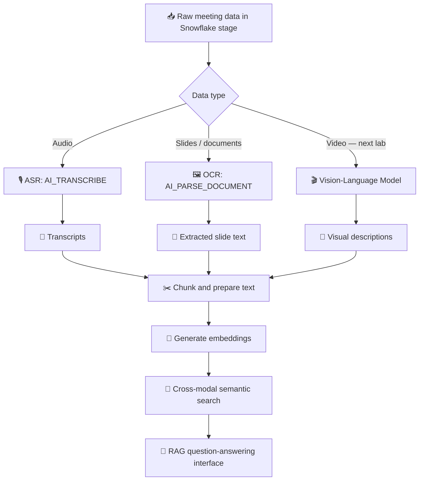

# 🎥 Building Multimodal Data Pipelines

> **My learning notes from a hands-on course on converting audio, images, and video into searchable knowledge using Snowflake, AI, embeddings, and Retrieval-Augmented Generation (RAG).**

## 📌 What I Learned

In this course, I learned how to build a **multimodal data pipeline** that can process different types of information—such as **audio recordings, images, slides, and videos**—and make them useful for search and question-answering.

The main idea is simple:

**Raw multimodal data → Text and descriptions → Chunks → Embeddings → Semantic search → RAG**

Once content is represented as text, I can apply familiar techniques like **chunking, vector embeddings, semantic similarity, retrieval, and RAG** to find relevant information and generate answers.

## 🧠 1. Understanding Multimodal Data

Multimodal data combines information from different formats:

| Modality | Example | What I want to extract |
|---|---|---|
| 🎙️ Audio | Meeting recordings | Spoken words and transcript text |
| 🖼️ Images | Slides, screenshots, scanned documents | Visible text, and potentially visual descriptions |
| 🎬 Video | Recorded meetings | Actions, scenes, interactions, and other visual context |

### Traditional techniques vs. newer AI techniques

| Technique | Input | Output | Best for |
|---|---|---|---|
| **ASR (Automatic Speech Recognition)** | Audio | Transcript | Converting speech into text |
| **OCR (Optical Character Recognition)** | Images or documents | Text visible in the image | Reading words from slides and documents |
| **VLM (Vision-Language Model)** | Images or video frames | Natural-language description or other visual understanding | Explaining what is happening in a scene |

**Example:** If an image shows a monkey holding a coconut in its right hand while looking toward the camera:

- **OCR** can read *written text* in the image, if any is present. It does **not** generally identify the monkey or its action.
- A basic **image classifier** might label the scene as *“monkey.”*
- A **VLM** can provide a richer description: *“A monkey is holding a coconut in its right hand while looking at the camera.”*

**My takeaway:** Different AI tools extract different kinds of information. Combining them gives a more complete view of the original data.

## 🔢 2. Understanding Embeddings

I learned that an **embedding** is a vector—a list of numbers—that represents the meaning of a piece of text (or other content).

For example, two sentences that express similar ideas can have embeddings that are close in **semantic meaning**, even when their wording is different.

### 📐 Cosine similarity

**Cosine similarity** compares the direction of two vectors by measuring the angle between them, rather than comparing their raw distance.

| Score | Interpretation |
|---|---|
| **+1** | Vectors point in the same direction |
| **0** | Vectors are orthogonal (no directional similarity) |
| **−1** | Vectors point in opposite directions |

For text embeddings, **higher cosine similarity usually indicates greater semantic similarity**. A negative score does not necessarily mean two sentences are exact opposites in ordinary language.

I learned why vector similarity is useful: it is **fast to compute and practical for searching large collections of content**.

## 🏗️ 3. End-to-End Pipeline Architecture

The course introduced an end-to-end pipeline using the **AMI Corpus**, a real dataset of product-design meetings. It contains:

- 🎙️ Meeting audio recordings
- 🖥️ Slides shown during meetings
- 🎬 Videos of participants collaborating

Because real meeting data is messy and distributed across multiple formats, it is a useful example of the challenges involved in multimodal processing.

I understood this architecture in **three stages**:

1. **Ingestion:** Access raw audio, slide, and video files stored in a Snowflake stage.
2. **Transformation:** Convert speech to transcripts, extract slide text, and describe video content using suitable AI models; then prepare text and create embeddings.
3. **Delivery:** Retrieve relevant information with semantic search and use it to support natural-language questions through RAG.

## 🧪 4. What I Completed in the Snowflake Lab

### ✅ Step 1 — Connected to Snowflake

I created a **Snowflake session** and configured a personal schema for my work.

### ✅ Step 2 — Transcribed audio into text

I used **`AI_TRANSCRIBE`** to convert meeting **WAV audio** into text transcripts, including duration metadata.

**Learning:** ASR makes spoken discussions searchable and reusable for downstream AI tasks.

### ✅ Step 3 — Extracted text from slides

I used **`AI_PARSE_DOCUMENT`** in **`LAYOUT` mode** to extract text and document layout information from slide images.

**Learning:** Slide content can become searchable without manually reading or copying each slide.

### ✅ Step 4 — Chunked the transcripts

I split long transcripts into **overlapping text chunks**.

**Why?** Smaller, focused chunks can improve retrieval, while overlap helps preserve context across chunk boundaries.

### ✅ Step 5 — Generated vector embeddings

I generated embeddings for **transcript chunks** and **extracted slide text** using the **`snowflake-arctic-embed-m`** model. Each embedding contained **768 dimensions**.

Two sets of vectors were now ready for retrieval:

| Source | Embedding field |
|---|---|
| 🎙️ Audio transcript chunks | `transcript_chunks.text_embedding` |
| 🖼️ Slide OCR text | `slides_ocr.text_embedding` |

### ✅ Step 6 — Performed semantic search on audio

I used **`VECTOR_COSINE_SIMILARITY`** to find relevant transcript chunks based on the *meaning* of a search query—not only exact keyword matches.

### ✅ Step 7 — Performed semantic search on slides

I retrieved relevant slides even when the query used different wording from the slide text.

### ✅ Step 8 — Combined audio and slide search

I used a **single natural-language query** to search both transcript and slide embeddings.

**My key achievement:** I built a retrieval foundation that can search across **two modalities—audio and slides—through their text representations**.

## 🔍 5. Why This Matters for RAG

**RAG (Retrieval-Augmented Generation)** combines retrieval of relevant source content with a language model that produces an answer grounded in that content.

For example, I could ask:

> “What design decisions did the team discuss, and which slides support those decisions?”

A multimodal RAG pipeline can retrieve relevant **meeting transcript chunks** and **slide content**, then provide an answer using both sources.

This approach is useful because the information needed to answer a question may be spread across different data types rather than stored in one document.

## 🚀 6. What Comes Next

The completed lab covered **audio and slides**. In the next labs, I will extend the pipeline to **video** by:

1. Processing meeting recordings with a **Vision-Language Model (VLM)**.
2. Generating meaningful descriptions of visual events and actions.
3. Embedding the new text representations.
4. Combining **audio, slides, and video** into a unified search experience.
5. Building a **multimodal RAG interface** for natural-language questions.

## 🛠️ Tools and Concepts I Practiced

- **Snowflake:** Sessions, schemas, staged data, and AI functions
- **ASR:** Audio transcription with `AI_TRANSCRIBE`
- **OCR / document parsing:** `AI_PARSE_DOCUMENT` in `LAYOUT` mode
- **Text preprocessing:** Chunking with overlap
- **Embeddings:** `snowflake-arctic-embed-m` (768-dimensional vectors)
- **Vector search:** `VECTOR_COSINE_SIMILARITY`
- **Retrieval:** Semantic search across transcripts and slides
- **Next steps:** VLM-based video understanding and multimodal RAG

## 📚 References

Official Snowflake documentation topics referenced in the course:

- **Cortex AI Functions: Audio** — Audio AI functions, including `AI_TRANSCRIBE`
- **Cortex AI Functions: Documents** — Document parsing, including `AI_PARSE_DOCUMENT`
- **AI_EMBED SQL Reference** — Generating vector embeddings with models such as `snowflake-arctic-embed-m`

## 🎯 Final Takeaway

This course helped me understand that **building a multimodal AI system is not just about using a language model**. It starts with transforming different data types into useful representations, then **chunking, embedding, searching, and retrieving** the right information.

I now have hands-on experience with the **audio + slide retrieval pipeline**, and a clear path toward adding **video understanding** and building a complete **multimodal RAG application**.
